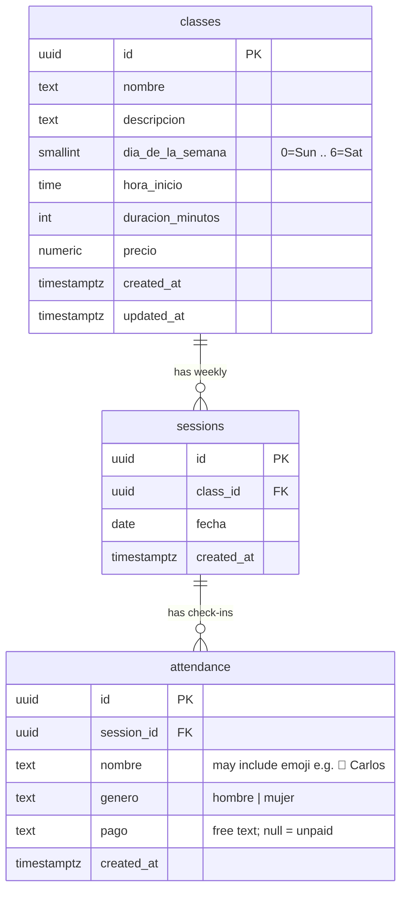
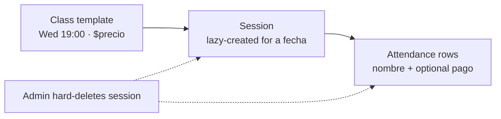

# Guapea Phase 1 — database schema

Postgres on Neon. Attendance is public (display name + autocomplete). Admin uses Neon Auth. Sessions are lazy-created per class + date; admin hard-deletes a session without removing the class template.

## Entity relationship

Neon Auth owns its own user/session tables (not drawn). Anyone who can sign in is treated as admin in Phase 1.

## Relationships

| From | To | Rule |
|------|-----|------|
| `sessions.class_id` | `classes.id` | `ON DELETE CASCADE` — deleting a template removes its sessions |
| `attendance.session_id` | `sessions.id` | `ON DELETE CASCADE` — destroying a session wipes that week’s check-ins |
| `(class_id, fecha)` on `sessions` | — | **UNIQUE** — one session per class per calendar day |

No `people` table: check-in stores a single `nombre` (emoji optional inside that string) + `genero`. Autocomplete = distinct `nombre` values from `attendance`.

## Lifecycle

- Opening a date for a class → upsert session `(class_id, fecha)` if missing.
- Admin destroys one session → that session + attendance gone; template stays.
- Metrics → aggregate `attendance` joined to `sessions` / `classes` (no metrics table).

## Column notes

### `classes`
Recurring definition only (not a single night).

| Column | Type | Notes |
|--------|------|--------|
| `id` | `uuid` | PK |
| `nombre` | `text` | Class title (not the attendee name) |
| `descripcion` | `text` | |
| `dia_de_la_semana` | `smallint` | `0`–`6`, Sunday = 0 |
| `hora_inicio` | `time` | |
| `duracion_minutos` | `int` | |
| `precio` | `numeric` | Used for revenue estimates (see metrics) |
| `created_at` / `updated_at` | `timestamptz` | |

### `sessions`
One iteration of a class on a calendar day.

| Column | Type | Notes |
|--------|------|--------|
| `id` | `uuid` | PK |
| `class_id` | `uuid` | FK → `classes` |
| `fecha` | `date` | |
| `created_at` | `timestamptz` | |

### `attendance`
One check-in; not a login identity.

| Column | Type | Notes |
|--------|------|--------|
| `id` | `uuid` | PK |
| `session_id` | `uuid` | FK → `sessions` |
| `nombre` | `text` | Display string as typed — emoji and name together (e.g. `🕺 Carlos`). No separate `emoji` column. |
| `genero` | `text` | `hombre` \| `mujer` (kept tight; used for gender split lists/charts) |
| `pago` | `text` | **Not a DB enum.** Free text (e.g. `efectivo`, `transferencia`, `suscripcion`, later `mercadopago`, …). `NULL` = unpaid / not set. UI can suggest common values. |
| `created_at` | `timestamptz` | |

## Auth boundary

- **Public API:** list classes for a date, lazy-create/get session, add/remove attendee, set payment, name autocomplete.
- **Admin API (Neon Auth):** CRUD `classes`, hard-delete `sessions`, richer metrics.

## Metrics: is this enough for graphs & revenue tables?

**Yes for Phase 1** — people counts and money estimates come from joins + aggregates, no extra tables.

| Question | How |
|----------|-----|
| How many people per session / class / week? | `COUNT(*)` on `attendance`, group by `session_id`, `class_id`, or `date_trunc('week', fecha)` |
| Gender split | `COUNT(*) FILTER (WHERE genero = …)` |
| Payment mix | `GROUP BY pago` (null = sin pagar) |
| Revenue estimate | e.g. `COUNT(*) FILTER (WHERE pago IS NOT NULL) * classes.precio`, or exclude methods in app logic (e.g. treat `suscripcion` differently) |

**Caveats (fine for POC, revisit later):**

1. **Price changes** — reports use current `classes.precio`. Changing the template rewrites historical revenue unless you later add `sessions.precio_snapshot`.
2. **Free-text `pago`** — charts by method work via `GROUP BY`; typos create duplicate buckets (`Efectivo` vs `efectivo`). Suggest normalizing in the UI (chips) while still allowing custom strings.
3. **What counts as revenue** — schema stores the method; the app decides which methods multiply by `precio`.
